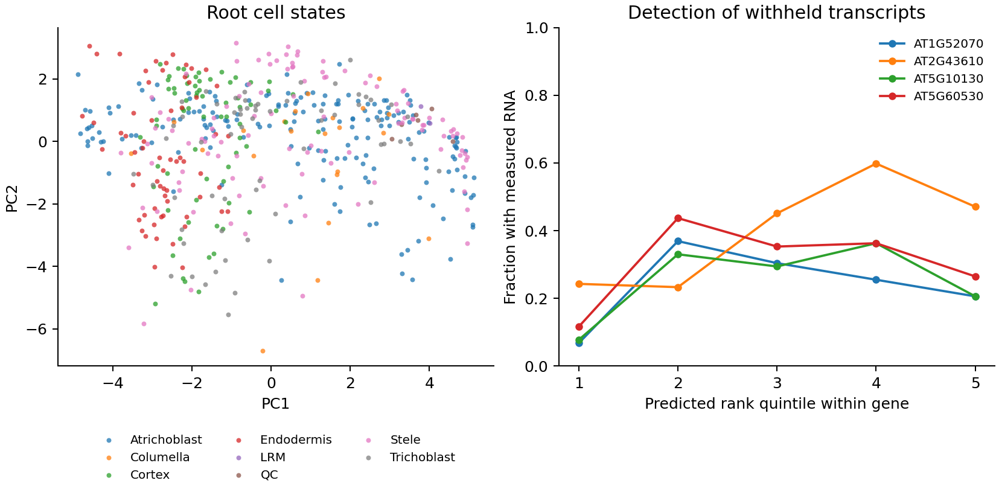

# Worked example: Arabidopsis root RNA

Use the original count matrix for [replicate I (GSM3478132)](https://www.ncbi.nlm.nih.gov/geo/query/acc.cgi?acc=GSM3478132) and the cell annotations from the [root atlas (GSE122687)](https://www.ncbi.nlm.nih.gov/geo/query/acc.cgi?acc=GSE122687). The example embeds cells from a single library and asks whether the remaining RNA ranks cells for detection of four withheld root-cap transcripts.

Run from a checkout of the repository:

```bash
python -m pip install . pandas scikit-learn "matplotlib>=3.6"
curl -fLO https://github.com/Qiu-Shizheng/PlantMultiFM/releases/download/v0.1.0/arabidopsis.npz
curl -fLO https://ftp.ncbi.nlm.nih.gov/geo/samples/GSM3478nnn/GSM3478132/suppl/GSM3478132_replicate_I_error_detected_200genes.dge.txt.gz
curl -fLO https://ftp.ncbi.nlm.nih.gov/geo/series/GSE122nnn/GSE122687/suppl/GSE122687_cell_metadata_with_tsne.csv.gz
python examples/root_atlas.py --panel arabidopsis.npz \
  --matrix GSM3478132_replicate_I_error_detected_200genes.dge.txt.gz \
  --metadata GSE122687_cell_metadata_with_tsne.csv.gz --out root-example
```

The script verifies both GEO files, joins labels to count columns by barcode, and matches measured genes to the panel. Labels colour the display and do not enter the encoder. For the right panel, all four targets are removed together before calculating depth or encoding the cell. Observed detection comes from the original counts. The left panel is a PCA visualization of this library, not a reference-mapping benchmark.



The command writes the figure and a cell-indexed coordinate table to the output directory.
